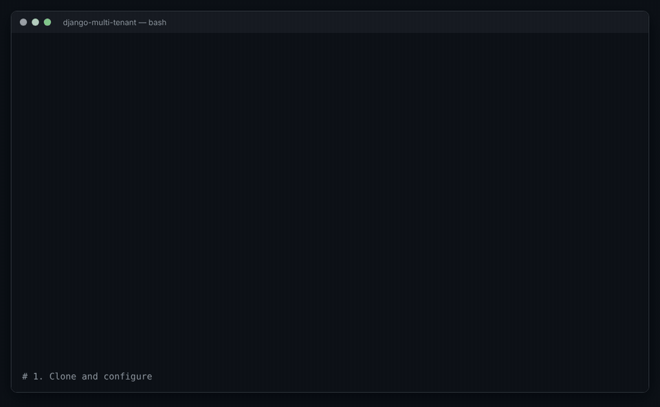
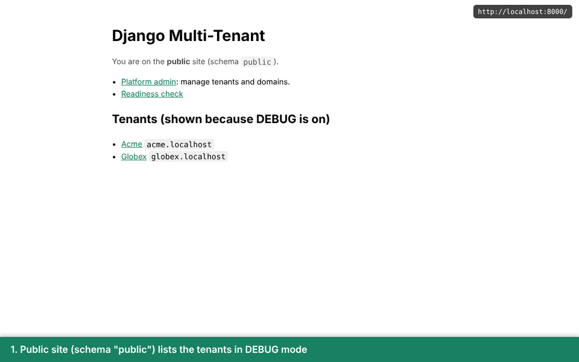
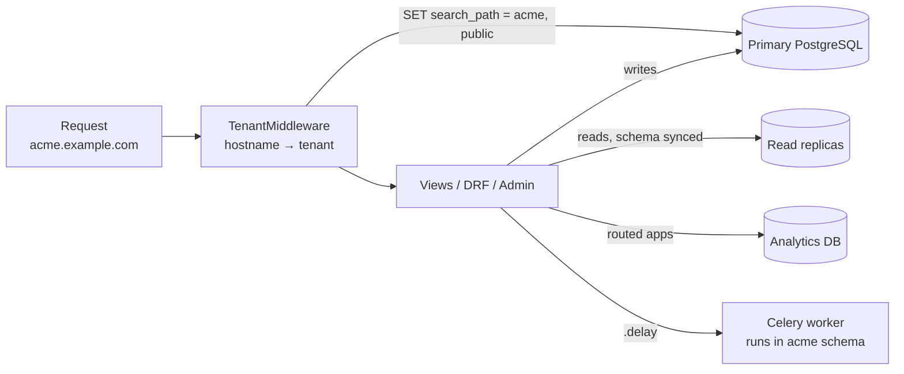

<div align="center">

# Django Multi-Tenant Boilerplate

**Production-ready SaaS starter for Django: one PostgreSQL schema per tenant, read replicas,
per-app databases, tenant-aware Celery, Docker Compose and uv. Fully documented, step by step.**

[](https://github.com/adityabhalsod/django-multi-tenant/actions/workflows/ci.yml)


[](https://github.com/astral-sh/uv)
[](https://github.com/astral-sh/ruff)
[](LICENSE)

[Demo](#-demo) · [Quick start](#-quick-start) · [Features](#-features) · [How it works](#-how-it-works) · [Documentation](docs/README.md) · [Contributing](CONTRIBUTING.md)

</div>

---

Building a SaaS means every customer must see **only their own data**, forever, no matter who
writes the next query. This boilerplate gives you that guarantee at the database level, plus
everything around it that usually takes weeks to get right: provisioning, domains, background
jobs, caching, files, multiple databases, Docker, CI and docs.

```text
http://localhost:8000          ->  public schema   (landing page, platform admin)
http://acme.localhost:8000     ->  "acme" schema   (Acme's users, data, admin, API)
http://globex.localhost:8000   ->  "globex" schema (Globex's users, data, admin, API)
```

## 🎬 Demo

**From `git clone` to two isolated tenants in a few commands** (real output from the Docker stack):



**A tour of what you get:** public site, platform admin, a tenant's own admin, the REST API,
Swagger UI, and proof that one tenant cannot see another's data:



## ✨ Features

**Multi-tenancy**
- 🏢 **Schema-per-tenant isolation** with [django-tenants](https://github.com/django-tenants/django-tenants): business code has *zero* tenant logic and still cannot leak data
- 🌐 Tenant resolved from the hostname: subdomains and custom domains, many domains per tenant
- 🚀 One-command provisioning (`provision_tenant`) with schema validation and rollback
- ⏸️ Suspend tenants (HTTP 403) without touching their data; schemas are never dropped by accident
- 👤 Per-tenant users, sessions and API tokens; separate platform-staff accounts
- 🛡️ Admin guard so tenant admins can never see platform models

**Databases**
- 🗄️ **Read replicas** from one env var, with automatic tenant-schema sync and read-your-writes pinning
- 🔀 **Per-app databases** (e.g. analytics/audit in a separate DB) via `DATABASE_APP_ROUTES`
- 🏊 Persistent connections or Django's native psycopg 3 pool

**Platform**
- ⚙️ Tenant-aware **Celery** + beat (tasks run in the schema they were queued from)
- 🧠 Tenant-safe **Redis cache** keys, per-tenant **media** storage (filesystem or S3)
- 🔌 **Django REST framework** API, token auth, Swagger UI (drf-spectacular)
- ❤️ Liveness and readiness probes that work behind load balancers
- 📝 Logs tagged with the tenant schema on every line

**Developer experience**
- ⚡ **uv** for Python and dependencies, locked and reproducible
- 🐳 **Docker Compose** dev stack (Postgres 18, Redis, Mailpit, worker, beat, optional streaming replica) and a production stack (gunicorn + nginx)
- ✅ Tests that prove isolation, GitHub Actions CI, Ruff, pre-commit, Makefile
- 📚 **14 step-by-step guides** covering every part of the setup

## 🚀 Quick start

**With Docker** (nothing else needed):

```bash
git clone https://github.com/adityabhalsod/django-multi-tenant.git && cd django-multi-tenant
cp .env.example .env
docker compose up -d --build
make tenant NAME="Acme" EMAIL=admin@acme.test PASSWORD=change-me-123
```

Open **http://acme.localhost:8000** (log in at `/admin/` as `admin`), the API docs at
**http://acme.localhost:8000/api/docs/**, and caught emails at **http://localhost:8025**.

**With uv** (Python on your machine):

```bash
docker compose up -d db redis mailpit     # or your own PostgreSQL + Redis
cp .env.example .env && uv sync
make local-run                            # migrates, bootstraps, runs the server
```

Full walkthrough: [docs/02-quickstart.md](docs/02-quickstart.md).

## 🧭 How it works



| Choose... | Shared schema | **Schema per tenant** | DB per tenant |
|---|---|---|---|
| Isolation | Filter in every query | **Enforced by PostgreSQL** | Strongest |
| Tenants | Millions | **Thousands+** | Tens |
| Per-tenant backup/restore | Hard | **`pg_dump -n acme`** | Easy |
| Code changes | Everywhere | **None** | Routers everywhere |

Why this model, and how the alternatives compare: [docs/01-architecture.md](docs/01-architecture.md).

## 📁 Project layout

```text
config/          settings (base/local/production/test), DB builder + router, URLs, Celery
apps/core/       middleware, health checks, tenancy helpers, primary pinning, admin guard
apps/tenants/    Tenant & Domain models, provisioning service, management commands
apps/users/      custom User (public + every tenant)
apps/projects/   example tenant app: model, DRF API, Celery task (copy this!)
apps/analytics/  example global app that can live in its own database
docker/          entrypoint, gunicorn, nginx, Postgres init + streaming replica
docs/            step-by-step guides
```

## 📚 Documentation

| | |
|---|---|
| [1. Architecture & research](docs/01-architecture.md) | [8. Building features](docs/08-building-features.md) |
| [2. Quick start](docs/02-quickstart.md) | [9. Background tasks](docs/09-background-tasks.md) |
| [3. uv](docs/03-uv.md) | [10. Cache, files, email](docs/10-cache-files-email.md) |
| [4. Docker](docs/04-docker.md) | [11. Deployment](docs/11-deployment.md) |
| [5. Configuration](docs/05-configuration.md) | [12. Testing](docs/12-testing.md) |
| [6. Managing tenants](docs/06-tenants.md) | [13. Security](docs/13-security.md) |
| [7. Multiple databases](docs/07-multiple-databases.md) | [14. Troubleshooting](docs/14-troubleshooting.md) |

## 🛠️ Common commands

```bash
make help            # list everything
make up / down       # start / stop the Docker stack
make tenant NAME=X   # create a tenant
make tenants         # list tenants and URLs
make migrate         # migrate public + all tenant schemas + extra databases
make test            # run tests in Docker  (make local-test with uv)
make lint / format   # ruff
```

## 🧱 Tech stack

Django 6.1 · django-tenants 4 · PostgreSQL 18 · Django REST framework · drf-spectacular ·
Celery 5 + tenant-schemas-celery · Redis 8 · psycopg 3 · gunicorn · WhiteNoise · uv · Ruff ·
pytest · Docker Compose · GitHub Actions

## 🤝 Contributing

Issues and pull requests are welcome. Read [CONTRIBUTING.md](CONTRIBUTING.md) to get set up
in two minutes. Please follow the [Code of Conduct](CODE_OF_CONDUCT.md) and report security
issues privately as described in [SECURITY.md](SECURITY.md).

## ⭐ Support

If this boilerplate saves you time, **give it a star**. It helps other developers find it.

## 📄 License

[MIT](LICENSE)
